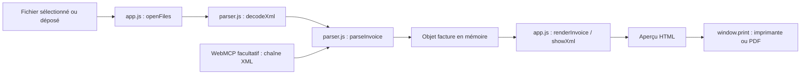

# Peppol Viewer — Conception technique

État documenté : version applicative **0.1.1**, mise à jour le **20 octobre 2026**.

Ce document décrit le fonctionnement implémenté, ses décisions de conception et
ses limites. Il complète le [README](../README.md), qui contient le démarrage rapide.
Les comportements décrits proviennent des fichiers du dépôt ; les références
Peppol servent à situer le format, sans constituer une certification du lecteur.

## Sommaire

1. [Objectif et périmètre](#1-objectif-et-périmètre)
2. [Architecture et décisions](#2-architecture-et-décisions)
3. [Cycle de lecture et état de l’interface](#3-cycle-de-lecture-et-état-de-linterface)
4. [Contrat du lecteur XML](#4-contrat-du-lecteur-xml)
5. [Mapping UBL vers l’aperçu](#5-mapping-ubl-vers-laperçu)
6. [Règles de restitution](#6-règles-de-restitution)
7. [Sécurité et confidentialité](#7-sécurité-et-confidentialité)
8. [Interface, accessibilité et impression](#8-interface-accessibilité-et-impression)
9. [Intégration WebMCP facultative](#9-intégration-webmcp-facultative)
10. [Tests et niveau de vérification](#10-tests-et-niveau-de-vérification)
11. [Exploitation, construction et publication](#11-exploitation-construction-et-publication)
12. [Maintenance et limites connues](#12-maintenance-et-limites-connues)
13. [Références](#13-références)

## 1. Objectif et périmètre

L’utilisateur dépose un fichier XML, obtient une présentation lisible de sa facture
et peut l’imprimer ou enregistrer un PDF avec son navigateur. Le contenu de la
facture est traité sur son appareil. Auteur : Bernard De Saedeleer.

Le lecteur accepte les racines UBL `Invoice` et `CreditNote` dont le
`CustomizationID` correspond exactement au profil codé dans le lecteur :

```text
urn:cen.eu:en16931:2017#compliant#urn:fdc:peppol.eu:2017:poacc:billing:3.0
```

Cette reconnaissance de format ne vérifie pas la conformité du document. Le code
ne contrôle ni l’ensemble des cardinalités UBL, ni les règles métier Peppol, ni
`ProfileID`. Un document partiellement renseigné peut donc être affiché.

| Inclus dans la version actuelle | Hors périmètre |
| --- | --- |
| Une facture ou note de crédit à la fois | Lots, historique, recherche et archivage |
| Lecture XML et aperçu synthétique en français | Édition, émission ou transmission de factures |
| Fournisseur, client, lignes, TVA, totaux et paiement | Recalcul comptable ou contrôle des coordonnées bancaires |
| Impression via le navigateur | Moteur PDF autonome ou PDF/A garanti |
| Application statique locale ou hébergée | Connexion à un point d’accès du réseau Peppol |
| Affichage des références documentaires et signalement des fichiers/liens | Ouverture des pièces jointes, décodage de leur Base64 |
| XML UBL directement à la racine | Enveloppes de transport, CII, Factur-X/PDF, autres profils |

## 2. Architecture et décisions

### 2.1 Composants



Tous les traitements de ce diagramme ont lieu dans l’onglet. Le serveur local ou
l’hébergement distribue les fichiers de l’application ; il ne reçoit pas les
factures par ce parcours.

| Fichier | Responsabilité |
| --- | --- |
| [index.html](../index.html) | Structure initiale, boutons, zones d’état, métadonnées et CSP |
| [parser.js](../parser.js) | Décodage, reconnaissance UBL, extraction, formatage textuel |
| [app.js](../app.js) | Événements, création du DOM, remplacement de l’aperçu, impression et WebMCP |
| [styles.css](../styles.css) | Présentation écran, adaptations mobiles et styles d’impression |
| [favicon.svg](../favicon.svg) | Icône statique locale |
| [mascot.png](../mascot.png) | Quatre expressions de la mascotte, sélectionnées par CSS |
| [scripts/serve.mjs](../scripts/serve.mjs) | Serveur HTTP local à liste de fichiers autorisés |
| [scripts/build.mjs](../scripts/build.mjs) | Prépare `dist/index.html` et le dossier `dist/assets/` |
| [scripts/version.mjs](../scripts/version.mjs) | Synchronise la version du pied de page depuis `package.json` |
| [tests/parser.test.mjs](../tests/parser.test.mjs) | Tests du lecteur et du formatage |
| [tests/app.test.mjs](../tests/app.test.mjs) | Tests de l’application avec un adaptateur DOM Node |
| [tests/fixtures/](../tests/fixtures/) | Exemples publics OpenPeppol et provenance |
| [package.json](../package.json), [pnpm-lock.yaml](../pnpm-lock.yaml) | Commandes et dépendance de développement verrouillée |

### 2.2 Choix structurants

| Décision | Pourquoi | Conséquence acceptée |
| --- | --- | --- |
| HTML, CSS et JavaScript natif | Réduire les composants à maintenir pour un seul parcours | Gestion explicite du DOM et de l’état |
| Traitement dans le navigateur | Éviter l’envoi des factures à un service de conversion | Mémoire et vitesse dépendent du poste et du navigateur |
| Scripts classiques chargés avec `defer` | Conserver un ordre de chargement simple et permettre l’ouverture locale | `parser.js` doit précéder `app.js` |
| Séparation extraction / restitution | Modifier le mapping sans mêler les règles XML à la création HTML | Un objet intermédiaire constitue le contrat interne |
| Montants conservés comme chaînes | Préserver les décimales et signes du document | Aucune vérification arithmétique des totaux |
| Impression native | Éviter une bibliothèque de génération PDF | Pagination et options dépendent du navigateur |
| Pas de persistance applicative | Garder un outil ponctuel sans gestion d’historique | Le document doit être rouvert après rechargement |

Il n’y a ni framework, ni transpilation, ni dépendance applicative à l’exécution.
`@xmldom/xmldom` **0.9.12** est uniquement utilisé par les tests Node. Le navigateur
utilise son propre `DOMParser`. Le champ `type: module` de `package.json` concerne
les scripts Node ; il ne transforme pas les scripts classiques de la page en modules.

## 3. Cycle de lecture et état de l’interface

### 3.1 Du fichier à l’aperçu

1. Le bouton déclenche le sélecteur natif. Sa valeur est remise à vide pour permettre
   de sélectionner à nouveau le même fichier.
2. La sélection ou le dépôt appelle `openFiles(files)`. Les événements de dépôt sont
   écoutés sur `document`, y compris lorsqu’un aperçu est déjà affiché.
3. `openFiles` exige exactement un fichier et vérifie `File.size`.
4. Le fichier est lu de façon asynchrone par `File.arrayBuffer()`.
5. `decodeXml` convertit les octets en chaîne, puis `showXml` appelle `parseInvoice`.
6. Le lecteur retourne un objet facture ; `renderInvoice` construit un
   `DocumentFragment` détaché.
7. Après extraction et préparation du rendu réussies, `showXml` remplace le contenu
   de `#invoice`, affiche les avertissements, masque l’accueil et affiche l’aperçu.
8. Le titre de l’onglet et la zone d’annonce sont mis à jour. Le focus est placé sur
   la facture et la page remonte en haut.

Le filtre `accept` du sélecteur facilite le choix d’un XML ; il ne constitue pas une
validation. Le contenu et les namespaces sont déterminants, y compris pour les
fichiers déposés sans extension `.xml`.

### 3.2 États et erreurs

| Situation | Comportement |
| --- | --- |
| Chargement initial | Accueil visible, aperçu et erreur masqués |
| Lecture en cours | Annonce « Lecture du fichier… » dans la zone de statut ; aperçu précédent conservé |
| Lecture réussie | Nouvel aperçu, nom de fichier et avertissements ; erreur précédente masquée |
| Échec avant le premier aperçu | Message d’erreur, accueil conservé |
| Échec après un aperçu | Message précisant que l’aperçu précédent est conservé |
| Annulation du sélecteur | Aucun changement de document |
| Plusieurs fichiers déposés | Refus de l’ensemble ; aucun traitement en lot |
| Rechargement de la page | Retour à l’accueil, sans restauration applicative |

La variable `loadSequence` numérote les tentatives de lecture. Si une nouvelle
tentative arrive pendant `arrayBuffer()`, le résultat de l’ancienne lecture est
ignoré. Le fichier n’est pas annulé au niveau système ; c’est son résultat qui
n’est plus appliqué. L’ouverture réussie par WebMCP invalide également une lecture
de fichier antérieure encore en attente.

Le modèle facture n’est pas conservé dans un magasin global. L’aperçu DOM porte les
données affichées ; le sélecteur natif peut garder la référence du dernier fichier
sélectionné jusqu’à sa remise à zéro ou au rechargement. Il n’y a pas de mécanisme
d’effacement sécurisé de la mémoire du navigateur.

## 4. Contrat du lecteur XML

### 4.1 API exposée

`parser.js` publie un objet gelé `globalThis.Peppol` :

| Fonction / constante | Entrée | Résultat |
| --- | --- | --- |
| `decodeXml(buffer)` | Octets compatibles avec `Uint8Array` | Chaîne XML ou exception |
| `parseInvoice(xml)` | Chaîne XML | Objet facture ou exception |
| `decimal(raw, minimum = 0)` | Valeur textuelle, nombre minimum de décimales | Texte formaté |
| `money(amount, fallback = '')` | `{ value, currency }`, devise de secours | Montant textuel ou `—` |
| `date(raw)` | Date textuelle | `JJ/MM/AAAA`, texte original ou `—` |
| `MAX_BYTES` | Sans objet | `5 * 1024 * 1024`, soit 5 242 880 octets |

Forme simplifiée du résultat, en notation de type documentaire :

```typescript
type Amount = { value: string; currency: string };
type Invoice = {
  credit: boolean;
  id: string;
  typeCode: string;
  issueDate: string;
  dueDate: string;
  currency: string;
  supplier: Party;
  customer: Party;
  payee: Party | null;
  references: [string, string][];
  lines: Line[];
  adjustments: Adjustment[];
  totals: Record<string, Amount>;
  taxAmount: Amount;
  taxes: TaxSubtotal[];
  payments: Payment[];
  terms: string[];
  notes: string[];
  warnings: string[];
};
```

Les structures `Party`, `Line`, `Adjustment`, `TaxSubtotal` et `Payment` sont des
objets JavaScript ordinaires décrits par le mapping ci-dessous. Cette notation
n’implique ni TypeScript dans le projet, ni validation automatique d’un schéma objet.

### 4.2 Décodage et limites

Le décodage choisit UTF-16 LE ou BE à partir du BOM ou des premiers octets de `<`.
Sinon, il examine les 250 premiers octets pour une déclaration XML `encoding` et
utilise UTF-8 par défaut. `TextDecoder` est appelé avec `fatal: true` ; un encodage
non reconnu ou une séquence invalide produit une erreur lisible.

La taille est contrôlée à trois endroits : taille du fichier avant lecture, taille
du tampon dans `decodeXml`, puis taille de la chaîne réencodée en UTF-8 dans
`parseInvoice`. Un fichier d’un encodage différent peut donc passer la limite en
octets d’origine mais être refusé après conversion en UTF-8.

La limite de **2 000 lignes** est vérifiée après la création du DOM XML. Les limites
bornent les entrées, mais ne sont pas des garanties de temps de réponse. Lecture
XML, extraction et création HTML s’effectuent sur le thread principal, sans Web
Worker, traitement en flux ou virtualisation du tableau.

### 4.3 Reconnaissance et extraction

Le lecteur refuse une chaîne vide, une DTD ou déclaration d’entité personnalisée,
un XML signalé mal formé par le parseur, une racine/URI inconnue, un
`CustomizationID` différent, l’absence de numéro/lignes/bloc de totaux, ou un
nombre de lignes supérieur à la limite.

Les chemins sont parcourus avec les fonctions internes `nodes`, `first`, `value`,
`values`, `attr` et `amount`. Il s’agit de parcours d’enfants directs par nom local
et URI, pas d’un moteur XPath. `value` prend le premier résultat et applique
`trim()` ; `values` collecte les textes non vides. Les namespaces utilisés sont :

| Préfixe documentaire | URI |
| --- | --- |
| Racine facture | `urn:oasis:names:specification:ubl:schema:xsd:Invoice-2` |
| Racine note de crédit | `urn:oasis:names:specification:ubl:schema:xsd:CreditNote-2` |
| `cbc` | `urn:oasis:names:specification:ubl:schema:xsd:CommonBasicComponents-2` |
| `cac` | `urn:oasis:names:specification:ubl:schema:xsd:CommonAggregateComponents-2` |

Un fournisseur peut changer les préfixes de son XML sans changer ces URI. Un élément
de même nom dans une autre URI n’est pas reconnu comme un champ UBL.

## 5. Mapping UBL vers l’aperçu

Les chemins suivants sont relatifs à la racine, sauf indication contraire. `@`
désigne un attribut. Pour tout `Amount`, le texte de l’élément devient `value` et
son attribut `currencyID` devient `currency`.

### 5.1 En-tête et références

| Champ interne / affichage | Chemin | Particularité |
| --- | --- | --- |
| `credit` / nature du document | Racine `CreditNote` ou `Invoice` | Le code type ne décide pas du libellé |
| `id` / numéro | `cbc:ID` | Obligatoire pour afficher |
| `typeCode` | `cbc:InvoiceTypeCode` ou `cbc:CreditNoteTypeCode` | Extrait mais non affiché |
| `issueDate` | `cbc:IssueDate` | Absence affichée `—` |
| `dueDate` | `cbc:DueDate` | Repli sur `cac:PaymentMeans/cbc:PaymentDueDate` ; bloc masqué si absent |
| `currency` | `cbc:DocumentCurrencyCode` | Vérification limitée à trois lettres majuscules |
| Commande | `cac:OrderReference/cbc:ID` | Premier résultat |
| Référence acheteur | `cbc:BuyerReference` | Omission si vide |
| Contrat | `cac:ContractDocumentReference/cbc:ID` | Premier résultat |
| Facture d’origine | `cac:BillingReference/cac:InvoiceDocumentReference/cbc:ID` | Références jointes par des virgules |
| Période | `cac:InvoicePeriod/cbc:StartDate` et `cbc:EndDate` | Dates formatées, réunies avec une flèche |
| Notes | `cbc:Note` | Tous les textes non vides |

### 5.2 Parties

Le fournisseur est lu sous `cac:AccountingSupplierParty/cac:Party`, le client sous
`cac:AccountingCustomerParty/cac:Party`, le bénéficiaire facultatif directement sous
`cac:PayeeParty`. Les chemins du tableau sont relatifs à cette partie.

| Champ interne | Chemin | Restitution |
| --- | --- | --- |
| `name` | `cac:PartyLegalEntity/cbc:RegistrationName` | Repli sur `cac:PartyName/cbc:Name` |
| `trading` | `cac:PartyName/cbc:Name` | Affiché s’il diffère du nom principal |
| `address` | `cac:PostalAddress` | Composition détaillée ci-dessous |
| `vat` | `cac:PartyTaxScheme/cbc:CompanyID` | Seulement les groupes dont `cac:TaxScheme/cbc:ID` vaut `VAT` |
| `registration` | `cac:PartyLegalEntity/cbc:CompanyID` | Identifiant légal |
| `endpoint` | `cbc:EndpointID` | Extrait mais non affiché ; `schemeID` non extrait |
| `contact` | `cac:Contact/cbc:Name`, `cbc:Telephone`, `cbc:ElectronicMail` | Textes simples, sans liens automatiques |

L’adresse réunit `StreetName`, `AdditionalStreetName`, les `AddressLine/Line`, le
code postal `PostalZone` et `CityName` sur une même ligne, `CountrySubentity`, puis
`Country/IdentificationCode`. Le code pays reste brut. Les chemins simples sont
préfixés `cbc`, les groupes `cac`.

Pour le bénéficiaire, l’interface n’affiche que son nom ou, à défaut, son identifiant
légal dans le bloc paiement. Son adresse et ses contacts extraits ne sont pas rendus.

### 5.3 Lignes

Chaque ligne est lue sous `cac:InvoiceLine` ou `cac:CreditNoteLine`.

| Champ interne | Chemin relatif à la ligne | Restitution |
| --- | --- | --- |
| `id` | `cbc:ID` | Extrait mais non affiché |
| `name` | `cac:Item/cbc:Name` | Intitulé principal |
| `descriptions` | `cac:Item/cbc:Description` | Textes secondaires |
| `notes` | `cbc:Note` | Sous la description |
| `quantity`, `unit` | `cbc:InvoicedQuantity` ou `cbc:CreditedQuantity`, `@unitCode` | Valeur et unité |
| `price` | `cac:Price/cbc:PriceAmount` | Prix net HT fourni |
| `priceBase`, `priceUnit` | `cac:Price/cbc:BaseQuantity`, `@unitCode` | « pour N unités » si renseigné |
| `taxCategory` | `cac:Item/cac:ClassifiedTaxCategory/cbc:ID` | Code et libellé connu |
| `taxPercent` | `cac:Item/cac:ClassifiedTaxCategory/cbc:Percent` | Pourcentage, y compris zéro |
| `amount` | `cbc:LineExtensionAmount` | Total HT de ligne fourni |
| `adjustments` | `cac:AllowanceCharge` | Remises/frais sous la description |

### 5.4 Remises et frais

La même extraction s’applique aux groupes `cac:AllowanceCharge` des lignes et de
la racine.

| Champ interne | Chemin relatif au groupe | Règle |
| --- | --- | --- |
| `charge` | `cbc:ChargeIndicator` | `true` ou `1` signifie frais ; toute autre valeur signifie remise |
| `reason` | `cbc:AllowanceChargeReason` | Repli sur `cbc:AllowanceChargeReasonCode` |
| `amount` | `cbc:Amount` | Valeur et devise d’origine |
| `base` | `cbc:BaseAmount` | Affichée uniquement dans le détail des ajustements globaux |
| `percent` | `cbc:MultiplierFactorNumeric` | Ajout du suffixe `%` sans calcul |

Les groupes de remise sous `cac:Price/cac:AllowanceCharge` ne sont pas extraits.
Le prix net reste affiché, sans développer la remise intégrée à sa formation.

### 5.5 TVA et totaux

Le lecteur recherche dans les `cac:TaxTotal` le premier groupe dont
`cbc:TaxAmount/@currencyID` correspond à `DocumentCurrencyCode` et qui contient des
`cac:TaxSubtotal`. À défaut, il prend le premier groupe de la même devise, même
sans ventilation. Il ne fusionne pas plusieurs groupes et ne prend pas le total
d’une autre devise pour remplacer la TVA de la facture.

| Champ de ventilation | Chemin relatif à `cac:TaxSubtotal` |
| --- | --- |
| Base taxable | `cbc:TaxableAmount` |
| Montant TVA | `cbc:TaxAmount` |
| Catégorie | `cac:TaxCategory/cbc:ID` |
| Taux | `cac:TaxCategory/cbc:Percent` |
| Exonération | `cac:TaxCategory/cbc:TaxExemptionReason`, sinon `cbc:TaxExemptionReasonCode` dans le même groupe |

Les totaux monétaires proviennent de `cac:LegalMonetaryTotal` :

| Élément `cbc` / clé de `totals` | Libellé | Affichage si absent |
| --- | --- | --- |
| `LineExtensionAmount` | Somme des lignes HT | Ligne omise |
| `AllowanceTotalAmount` | Remises globales | Ligne omise |
| `ChargeTotalAmount` | Frais globaux | Ligne omise |
| `TaxExclusiveAmount` | Total HT | `—` et avertissement |
| `TaxInclusiveAmount` | Total TTC | `—` et avertissement |
| `PrepaidAmount` | Déjà payé / acomptes | Ligne omise |
| `PayableRoundingAmount` | Arrondi | Ligne omise |
| `PayableAmount` | Montant à payer / à créditer | `—` et avertissement |

La ligne récapitulative « TVA » vient du `TaxTotal` retenu, pas de
`LegalMonetaryTotal`. Aucun taux effectif ou total manquant n’est calculé.

### 5.6 Paiement et documents associés

Tous les groupes `cac:PaymentMeans` sont parcourus.

| Champ interne | Chemin relatif au groupe | Libellé |
| --- | --- | --- |
| `code` | `cbc:PaymentMeansCode` | Moyen de paiement connu, sinon code brut |
| `reference` | `cbc:PaymentID` | Communication |
| `account` | `cac:PayeeFinancialAccount/cbc:ID` | Compte / IBAN |
| `name` | `cac:PayeeFinancialAccount/cbc:Name` | Titulaire |
| `bank` | `cac:PayeeFinancialAccount/cac:FinancialInstitutionBranch/cbc:ID` | Banque / BIC |
| `mandate` | `cac:PaymentMandate/cbc:ID` | Mandat |

Les conditions de paiement viennent de `cac:PaymentTerms/cbc:Note`. Ni IBAN, ni BIC,
ni communication ne sont validés ou transformés en ordre de paiement.

Les groupes racine `cac:AdditionalDocumentReference` alimentent `documents` :
identifiant, description, type, noms des fichiers joints et nombre de liens externes.
Ils sont affichés dans « Documents complémentaires » ; le code `130` est présenté
comme une référence à l’objet facturé. Une référence seule ne déclenche pas d’avertissement.

Seuls les `cbc:EmbeddedDocumentBinaryObject` non vides, sous `cac:Attachment`,
sont comptés comme pièces jointes. Les `cbc:URI` non vides, sous
`cac:Attachment/cac:ExternalReference`, sont comptés séparément comme liens externes.
Ces deux catégories produisent des messages distincts. Le Base64 n’est ni conservé
dans le modèle normalisé ni décodé ; les URL ne sont ni conservées dans ce modèle,
ni affichées sous forme de liens actifs, ni ouvertes. Les métadonnées sont insérées
dans l’aperçu uniquement comme texte.

## 6. Règles de restitution

### 6.1 Montants et dates

`decimal` reconnaît un signe facultatif, des chiffres et une fraction facultative
introduite par un point. Il groupe les milliers par espaces fines insécables
(`U+202F`) et utilise la virgule décimale. `money` ajoute au moins deux décimales,
sans tronquer les décimales supplémentaires, puis une espace insécable (`U+00A0`)
et la devise du montant, ou la devise générale en repli.

| Entrée | Résultat textuel |
| --- | --- |
| Montant `1234.5`, devise `EUR` | `1 234,50 EUR` |
| Montant `-12.10`, devise `EUR` | `-12,10 EUR` |
| Montant `0`, devise `EUR` | `0,00 EUR` |
| Décimal `9007199254740993.123456` | `9 007 199 254 740 993,123456` |
| Montant absent | `—` |

Une valeur non vide qui ne correspond pas au motif numérique reste affichée comme
texte d’origine. Le lecteur ne vérifie pas qu’un montant est un décimal UBL valide,
ni que toutes les devises sont cohérentes. Une chaîne `0` est une valeur présente,
elle ne doit pas être confondue avec une donnée manquante.

`date` transforme seulement la forme `AAAA-MM-JJ` en `JJ/MM/AAAA`. Elle ne contrôle
pas la validité calendaire et ne réalise aucune conversion de fuseau horaire.

### 6.2 Notes de crédit

La racine `CreditNote` change le titre, le chemin des lignes et des quantités, ainsi
que le libellé final « Montant à créditer ». Les signes des montants et quantités
ne sont jamais inversés. Une facture négative reste une `Invoice` affichée comme
facture ; un code type particulier n’entraîne pas de présentation spécialisée.

### 6.3 Libellés et données absentes

Les tables de libellés sont locales à `app.js` :

- Unités reconnues : `C62`, `H87`, `HUR`, `DAY`, `MON`, `KGM`, `MTR`, `MTK`, `LTR`,
  `KWH`, `XPP`.
- Catégories fiscales reconnues : `S`, `Z`, `E`, `AE`, `K`, `G`, `O`, `L`, `M`.
- Moyens de paiement reconnus : `10`, `30`, `42`, `48`, `49`, `58`, `59`.

Ces listes sont un sous-ensemble d’affichage et ne constituent pas des listes de
validation exhaustives. Un code non traduit reste visible sous sa forme brute.

Les avertissements couvrent une devise absente ou inhabituelle, l’absence du total
TVA dans la devise de facture, les trois totaux clés absents, le nom manquant du
fournisseur ou du client, les pièces jointes et liens externes non ouverts, et les lignes sans nom, quantité
ou montant. D’autres absences peuvent se traduire par un tiret ou l’omission du
champ sans avertissement spécifique.

## 7. Sécurité et confidentialité

### 7.1 Frontières de confiance

Le XML et le nom du fichier sont considérés comme du texte non fiable. La page
créée par le projet est le composant de confiance chargé de les lire. Le modèle
XML n’est pas inséré directement dans le document HTML.

| Mesure implémentée | Effet et limite |
| --- | --- |
| Création d’éléments puis affectation par `textContent` | Les noms, notes et descriptions ne deviennent pas du HTML actif |
| Refus préalable de `DOCTYPE` et `ENTITY` | Pas de traitement de DTD ou d’entités personnalisées ; les entités XML usuelles restent lisibles |
| Aucun chargement des URL ou pièces jointes du XML | Pas de récupération automatique de ressources indiquées dans la facture |
| Limites de taille et de lignes | Réduction de la charge admise ; aucune limite spécifique de profondeur XML |
| Absence de `fetch`, stockage web, analytics ou base applicative | Aucun envoi ou archivage de facture par le code applicatif |
| `.gitignore` exclut `private/` et les `.env` réels | Prévention de versionnement accidentel, pas contrôle d’accès au système de fichiers |

Le test lexical des DTD est volontairement conservateur : il peut aussi refuser
une mention de ces déclarations dans un commentaire ou une section CDATA.

### 7.2 Politique de contenu

La CSP est déclarée dans une balise `meta` de `index.html` :

```text
default-src 'self'; script-src 'self'; style-src 'self';
img-src 'self' data:; connect-src 'none'; object-src 'none';
base-uri 'none'; form-action 'none'
```

Les scripts et styles applicatifs sont des fichiers locaux. `connect-src 'none'`
interdit les connexions programmatiques couvertes par cette directive ; les objets
embarqués, changements de base et soumissions de formulaires sont également bloqués.
Cette politique complète l’insertion textuelle, sans remplacer la sécurité du
navigateur ou les contrôles de l’hébergeur. Elle ne promet pas de contrôler toutes
les activités réseau du navigateur, ses extensions ou son environnement hôte.

### 7.3 Conservation des données

Le code ne conserve pas la facture dans `localStorage`, `sessionStorage`, IndexedDB
ou un service worker. Recharger ferme le parcours courant sans restauration
applicative. En revanche, le nom/numéro peuvent apparaître dans l’interface et le
titre de l’onglet ; l’utilisateur peut imprimer ou enregistrer le résultat. La
visionneuse ne contrôle ni ces exports, ni l’historique ou les mécanismes internes
du navigateur.

Le serveur local n’implémente pas de téléversement : il ne lit pas de corps de
requête pour enregistrer ou convertir une facture. La version hébergée possède
un contrôle d’accès Sites distinct du traitement de la facture. Charger une page
hébergée implique des requêtes pour l’application et son accès, même si le contenu
du XML reste traité localement par le lecteur.

## 8. Interface, accessibilité et impression

L’interface comporte deux sections d’une même page, pilotées par `hidden`. Aucun
routeur n’est utilisé et le document ouvert n’est pas placé dans l’URL.

| Élément | Mise en œuvre |
| --- | --- |
| Clavier | Boutons natifs pour sélectionner et imprimer, focus visible sur les boutons |
| Erreurs | `role="alert"` sur `#error` |
| Annonces | `role="status"`, `aria-live="polite"` sur une zone visuellement masquée |
| Aperçu | Article doté d’un libellé et de `tabindex="-1"` pour le focus programmatique |
| Tableau des lignes | Légende masquée et en-têtes `scope="col"` |
| Mobile | Réorganisation à 700 px, adaptation supplémentaire à 380 px, tableau défilant |
| Typographie | Polices système de repli ; aucun téléchargement de police |

Ces dispositifs sont présents dans le code. Ils ne constituent pas un audit
d’accessibilité ni une vérification avec lecteur d’écran.

Le bouton « Imprimer / PDF » appelle uniquement `window.print()`. L’utilisateur
choisit son imprimante ou l’enregistrement PDF dans la boîte de dialogue.

Les règles CSS demandent du papier A4 avec marges de 14 mm, retirent la barre
d’actions, l’accueil, les décorations et les messages d’erreur, conservent les
avertissements, réactivent l’affichage complet du tableau et demandent la répétition
de ses en-têtes. Les lignes et certains blocs utilisent `break-inside: avoid`.

Les montants, devises, quantités et en-têtes restent sur une seule ligne. Le tableau
réserve aux colonnes numériques la largeur nécessaire à leur contenu ; les
descriptions utilisent l’espace restant et peuvent revenir à la ligne. Les règles
de mise en page mobile sont limitées au média `screen` pour ne pas modifier l’A4.

Le navigateur reste responsable de la pagination ; un bloc plus grand qu’une page
ne peut pas toujours rester indivisible. Le nom de fichier PDF, les en-têtes/pieds
de page et les options d’impression ne sont pas pilotés par le code. La note sous
l’aperçu sur l’absence de certification est masquée à l’impression.

## 9. Intégration WebMCP facultative

Cette section documente l’API expérimentale telle qu’utilisée par le code ; elle
n’affirme pas sa disponibilité dans tous les navigateurs.

Au chargement, `app.js` vérifie `document.modelContext?.registerTool`. Si elle est
disponible, l’application enregistre un seul outil `open_peppol_xml` :

| Propriété | Valeur / comportement |
| --- | --- |
| `xml` | Chaîne requise ; `maxLength` déclaré à `MAX_BYTES` dans le schéma |
| `filename` | Chaîne facultative, 255 caractères au maximum ; défaut `facture.xml` |
| Propriétés supplémentaires | Refusées par le schéma et le contrôle explicite |
| `readOnlyHint` | `false` : l’appel remplace l’état visible |
| `untrustedContentHint` | `true` : le XML provient d’une entrée externe |
| Action | Appel du même `showXml` que pour les fichiers |
| Résultat | `{ type: 'invoice' ou 'credit_note', lineCount, warningCount }` |
| Échec d’entrée | Exception ; l’échec de parsing conserve l’aperçu précédent |

Le schéma mesure une longueur de chaîne ; le lecteur contrôle aussi les octets de
la représentation UTF-8. Ces deux limites ne sont pas interchangeables. Cette
entrée reçoit déjà du texte et ne passe pas par `decodeXml`.

L’enregistrement utilise un `AbortController`, annulé à l’événement `pagehide`.
Une API absente ou un échec d’enregistrement ne bloque pas la lecture par fichier.
Il n’y a pas de polyfill ni de mécanisme spécifique de réenregistrement au retour
depuis le cache de navigation. Le contrat est testé dans l’adaptateur Node ; son
fonctionnement natif n’a pas été vérifié.

## 10. Tests et niveau de vérification

### 10.1 Suite automatisée

La suite actuelle contient **23 tests : 14 pour le lecteur, 7 pour l’application
et 2 pour la synchronisation des versions**.
Elle s’exécute avec le lanceur natif `node:test`. Les commandes reproductibles se
trouvent dans la section exploitation.

| Groupe | Couverture présente |
| --- | --- |
| Facture de référence | Parties, deux lignes, quantités et montants attendus indépendants |
| Note de crédit | Nature du document, quantité créditée et montant d’origine |
| Ajustements | Remises, frais, acompte, plusieurs catégories TVA |
| Documents complémentaires | Référence seule sans avertissement, fichiers/liens comptés séparément, champs vides ou namespace étranger ignorés, métadonnées rendues comme texte |
| Devises et exonération | GBP, montant TVA nul et motif d’exonération |
| Namespaces | Préfixes renommés, URI incorrecte refusée |
| TVA comptable distincte | Un total USD ne remplace pas la TVA EUR de facture |
| Formatage | Grande précision décimale, valeur négative, zéro et valeur absente |
| Entrées refusées | Vide, XML mal formé, format inconnu, profil différent, DTD, dépassement de taille |
| Encodages | UTF-8, UTF-16 LE, ISO-8859-1 déclaré et octets invalides |
| Données incomplètes | Total payable absent et bloc de totaux absent |
| Application | Outil enregistré, aperçu mis à jour, entrée invalide sans remplacement |
| Injection | Balises dans le fournisseur et le nom de fichier restant du texte |
| Événements | Dépôt simulé, refus de plusieurs fichiers, délégation de l’impression |

Les fixtures et leur provenance sont documentées dans
[tests/fixtures/README.md](../tests/fixtures/README.md). Les quatre fichiers XML
proviennent de l’archive OpenPeppol de mai 2026. Aucun document personnel n’est
nécessaire à l’exécution des tests.

L’adaptateur de `tests/app.test.mjs` fournit un DOM minimal et simule des méthodes
comme `focus`, `click` et `window.print`. Le parseur de test traite les erreurs
différemment du `DOMParser` natif. Ces tests vérifient le code applicatif, pas la
compatibilité réelle de toutes les API navigateur.

### 10.2 Vérifications manuelles restantes

Les contrôles suivants restent à réaliser et à consigner avec la version du
navigateur, le document utilisé et le résultat obtenu :

1. Sélection native et glisser-déposer réels, réouverture du même fichier,
   annulation, erreur après un aperçu et ouvertures rapprochées.
2. Lisibilité avec noms longs, descriptions multilignes, montants élevés,
   plusieurs taux et codes inconnus.
3. Navigation clavier, annonces d’erreur au lecteur d’écran et zoom à 200 %.
4. Affichage mobile et défilement du tableau sans perte d’information.
5. Impression/PDF de factures courtes et longues, répétition des en-têtes,
   coupures, avertissements et note de crédit.
6. Ouverture directe en `file://`, chargement HTTP local et accès Sites.
7. WebMCP natif si le navigateur expose cette capacité.
8. Charge près des limites de taille/lignes et XML fortement imbriqué.

La suite ne couvre pas exhaustivement les encodages, la limite exacte de 2 000
lignes, les courses asynchrones ou chaque branche d’erreur. Un build réussi ou les
23 tests passants ne remplacent pas ces vérifications.

## 11. Exploitation, construction et publication

### 11.1 Exécution locale

Pour l’usage direct, ouvrir `index.html` avec un navigateur moderne. Node et pnpm
servent au développement et ne sont pas requis pour le traitement du XML dans
l’onglet. Le fonctionnement direct reste à confirmer dans les navigateurs visés.

Pour démarrer le serveur de développement, depuis le dossier du projet :

```powershell
Set-Location -LiteralPath 'V:\Peppol Viewer'
node scripts/serve.mjs
```

Ouvrir [l’aperçu local](http://127.0.0.1:4173). Le serveur reste actif jusqu’à Ctrl+C.
Il écoute exclusivement sur `127.0.0.1:4173` ; le port n’est pas configurable dans
cette version. Une erreur `EADDRINUSE` signifie qu’un autre processus utilise déjà
ce port : identifier cette instance avant de décider de l’arrêter ou de la réutiliser.

Le serveur lit les fichiers sources à chaque requête, sans rechargement automatique
de la page. Les réponses utilisent `Cache-Control: no-store`, un type MIME explicite
et `X-Content-Type-Options: nosniff`. Un chemin absent de la liste des six fichiers
autorisés retourne 404. `docs/`, les fixtures et les fichiers de configuration ne
sont pas servis. Il ne s’agit pas d’un serveur de production.

### 11.2 Installation de développement et contrôles

Base documentée : Node.js **22 ou ultérieur** et pnpm disponible. Les chemins
d’installation des outils propres au poste ne sont pas nécessaires au projet.

```powershell
pnpm install --frozen-lockfile
pnpm test
pnpm build
```

Après installation, les commandes directes équivalentes sont :

```powershell
node --test tests/*.test.mjs
node scripts/build.mjs
```

`pnpm dev` lance le même serveur local. Il n’y a actuellement ni linter déclaré,
ni contrôle de types, ni pipeline CI configuré dans le dépôt.

### 11.3 Livrable statique

Le build synchronise la version et crée `dist/` si nécessaire. Il place uniquement
`index.html` à la racine, et `styles.css`, `parser.js`, `app.js`, `favicon.svg` et
`mascot.png` dans `dist/assets/`. Les quatre chemins de chargement de l’HTML sont
réécrits vers `./assets/`. La mascotte reste à côté de la feuille de style qui la
référence. Tous ces chemins restent relatifs et se résolvent aussi en `file://`.
Le build ne compile, ne minifie et ne valide pas le code. Les tests sont donc une
commande distincte ; ils contrôlent également les ressources de cette distribution.

Le build retire uniquement les cinq anciens fichiers techniques directement sous
`dist/`, après avoir écrit la nouvelle structure. Il ne supprime aucun autre fichier.
Pour une publication, construire dans un checkout propre ou vérifier que la sortie
contient seulement `index.html` et les cinq fichiers de `assets/`. Ne jamais y
déposer de facture, secret ou archive personnelle. Les répertoires source `docs/`
et `tests/` ne font pas partie de la distribution.

Un hébergement statique peut distribuer le contenu de `dist/`, en conservant les
chemins relatifs entre les six fichiers. L’application n’a besoin d’aucune variable
d’environnement. [.env.example](../.env.example) le rappelle ; aucun secret ne doit
être injecté dans les scripts publics.

### 11.4 Publication du code sur GitHub

Le dépôt contient les six fichiers de l’application, les scripts, le lockfile,
les tests, les exemples fictifs, le README et la documentation technique.
Les fichiers locaux de configuration d’hébergement (`.openai/`), les dépendances
installées, les archives et les factures personnelles ne font pas partie du dépôt.

Avant une distribution, exécuter les tests, renseigner la version dans
`package.json` et les changements dans `CHANGELOG.md`, puis construire `dist/`.
Distribuer `index.html` et son dossier `assets/` ensemble. Le code publié et les distributions restent
utilisables localement ; la présence du dépôt sur GitHub n’active aucun envoi de
facture ni hébergement de l’application.

Un changement exclusivement documentaire n’exige pas de redistribuer l’application :
le document technique est destiné au dépôt, pas aux fichiers ouverts dans le navigateur.

### 11.5 Retour arrière

Identifier le commit ou la version précédemment fonctionnelle. Pour une utilisation
locale, préparer un checkout distinct de ce commit et reconstruire une sortie
statique propre. Cette méthode conserve les travaux en cours sans réinitialisation
destructive. Avec Sites, republier la version enregistrée retenue selon les règles
d’accès applicables. Il n’y a aucune migration de base de données à inverser.

## 12. Maintenance et limites connues

### 12.1 Ajouter un champ ou corriger un mapping

1. Identifier un cas réel anonymisé ou un exemple public et le chemin UBL précis.
2. Définir le comportement attendu lorsque le champ manque ou apparaît plusieurs fois.
3. Compléter l’extraction dans `parser.js`, puis le rendu textuel dans `app.js`.
4. Ajouter un test portant sur la valeur attendue et le cas limite qui motive le changement.
5. Vérifier l’écran et l’impression si la présentation change.
6. Actualiser le mapping de ce document et le périmètre du README si nécessaire.

Pour un nouveau profil ou format, réexaminer explicitement la reconnaissance et
les différences sémantiques. Assouplir seulement le contrôle de `CustomizationID`
ne démontre pas la prise en charge du nouveau format.

### 12.2 Points à connaître avant d’étendre

| Limite actuelle | Conséquence pratique |
| --- | --- |
| Pas de XSD/Schematron ou contrôle des cardinalités | Des erreurs métier peuvent rester invisibles |
| Première occurrence pour beaucoup de champs simples | Les répétitions inattendues ne sont pas toutes restituées |
| Mapping synthétique | Certaines informations de livraison, propriétés d’articles, détails de prix et identifiants restent hors aperçu |
| Devise seulement reconnue par sa forme | Un code de trois lettres n’est pas nécessairement une devise valide |
| Date et nombre formatés sans validation métier | Des valeurs invalides peuvent rester visibles telles quelles |
| `ChargeIndicator` interprété comme remise sauf `true`/`1` | Une valeur manquante ou incorrecte n’est pas signalée spécifiquement |
| Traitement synchrone après lecture du fichier | Une entrée volumineuse peut bloquer temporairement l’interface |
| CSS d’impression sans moteur de pagination dédié | Le PDF peut varier selon le navigateur |
| Documentation et tests non inclus dans `dist/` | Consultation technique via le dépôt, pas par une URL de l’application |

La priorité de maintenance est la justesse de l’extraction et la lisibilité sur
les factures utilisées, avant l’ajout de formats, de persistance ou de fonctions
de validation. Les limites relevées ici sont documentées ; elles ne sont pas des
correctifs déjà implémentés ni des évolutions automatiquement engagées.

## 13. Références

- [Documentation OpenPeppol BIS Billing 3.0](https://docs.peppol.eu/poacc/billing/3.0/).
- [Syntaxe UBL Invoice](https://docs.peppol.eu/poacc/billing/3.0/syntax/ubl-invoice/).
- [Syntaxe UBL CreditNote](https://docs.peppol.eu/poacc/billing/3.0/syntax/ubl-creditnote/).
- [Provenance des fixtures conservées dans le dépôt](../tests/fixtures/README.md).
- [DOMParser — documentation MDN](https://developer.mozilla.org/en-US/docs/Web/API/DOMParser/parseFromString).

Les pages officielles non datées peuvent évoluer. Pour reproduire les tests de
cette version, utiliser les fichiers effectivement versionnés et le lockfile du
commit retenu. Mettre à jour la date de ce document lorsque le comportement décrit
change ; garder le README comme point d’entrée et cette conception comme référence
technique détaillée.
